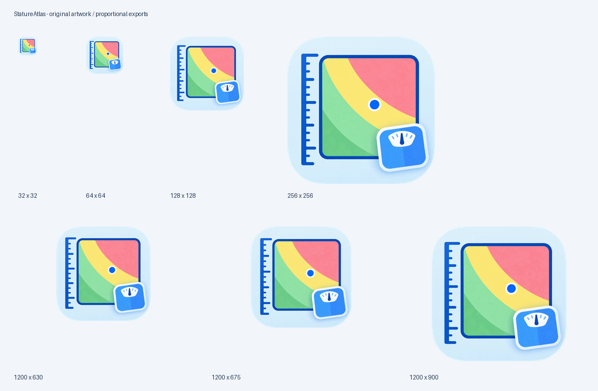

# StatureAtlas 品牌图标

以 1254 × 1254 px 透明 PNG 为母版，保留蓝色标尺、彩色 BMI 区间、蓝色标记点与体重秤。所有导出均等比缩放；横版使用透明留边，不拉伸、不裁切主体。圆角底板铺满方形画布，底板外的四角为真实 Alpha 透明；内部浅蓝底色及白色图案保持不透明。导出脚本使用 RGBA，避免重新填入白底。

## 资源

| 文件 | 尺寸 / 比例 | 用途 |
| --- | --- | --- |
| `icon-source.png` | 1254 × 1254，1:1 | 透明母版 |
| `../../public/icons/icon-{size}.png` | 16、32、48、64、96、128、180、192、256、384、512、1024 px，1:1 | 网页、品牌展示、桌面快捷方式等 |
| `../../public/favicon.ico` | 包含 16、32、48 px | 浏览器图标 |
| `../../public/apple-touch-icon.png` | 180 × 180，1:1 | Apple Touch Icon |
| `../../public/brand/stature-atlas-1200x630.png` | 1200 × 630，40:21（约 1.91:1） | 社交分享尺寸素材 |
| `../../public/brand/stature-atlas-1200x675.png` | 1200 × 675，16:9 | 横版展示 |
| `../../public/brand/stature-atlas-1200x900.png` | 1200 × 900，4:3 | 横版展示 |
| `stature-atlas-icons.zip` | 原图 + 全部 17 个导出文件 | 打包下载 |

网页页头、浏览器 favicon、Apple Touch Icon 与主 README 已引用新图标。横版仅作为素材提供，未添加社交分享页面元数据或 PWA 功能。

原图包含较多细节，16 / 32 px 尺寸会自然损失细节；未为小尺寸重绘图案。

## 重新导出

需要 Python 3 与 Pillow：

```bash
python3 -m pip install Pillow
python3 scripts/resize-icons.py
```

脚本位于项目根目录的 `scripts/` 中，可从任意工作目录执行其路径。替换母版后运行，重新导出全部尺寸、资源包与预览图。


